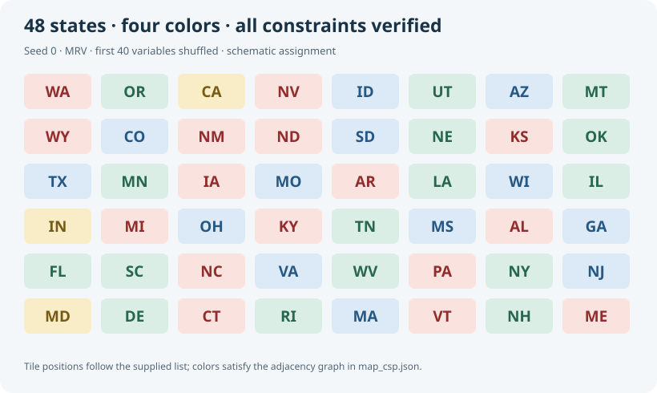

<div align="center">
  <h3 align="center">CSP Map Coloring</h3>

  <p align="center">
    A Python graph-coloring solver comparing <strong>Backtracking</strong>, <strong>Minimum Remaining Values</strong>, and <strong>Forward Checking</strong> on a 48-state map.
    <br />
    <a href="#-getting-started"><strong>Quick Start »</strong></a>
  </p>

  <p align="center">
    
    
    
    
  </p>
</div>

## 🔍 About The Project

This project formulates map coloring as a **Constraint Satisfaction Problem (CSP)**: assign one of four colors to each of 48 states so that neighboring states always have different colors.

Three solvers expose the trade-off between search effort and inference overhead. Plain backtracking follows a fixed variable order, MRV chooses the most constrained remaining variable, and Forward Checking removes conflicting colors from neighboring domains before descending into the next branch.

The portfolio edition corrects the original benchmark: every seed starts from the same reference map, all algorithms receive the same order, and every returned assignment is checked against the constraints. Per-run records distinguish a solution, a proven failure, and an exhausted search budget.

*Built as a University of Cincinnati academic AI project focusing on search heuristics, constraint propagation, and reproducible experiments.*

## 🛠 Built With

- **Language:** Python 3.10+
- **Core Libraries:** `copy`, `random`, `time`, `statistics`, `csv`, `json`
- **Algorithms:** Backtracking, MRV, Forward Checking
- **Testing:** Standard-library `unittest`
- **External Runtime Dependencies:** None

## 📐 Architecture

```text
Reference map JSON → Fresh seeded variable order → Independent solver inputs
                                                        │
                           ┌────────────────────────────┼──────────────────────┐
                           ▼                            ▼                      ▼
                       Backtracking                    MRV                  MRV + FC
                           └────────────────────────────┼──────────────────────┘
                                                        ▼
                                     Complete assignment + constraint checks
                                                        ▼
                                        Per-run CSV + benchmark summary
```

### Technical Highlights

- **Explicit CSP Model:** variables are states, domains are colors, and binary constraints forbid equal colors across an edge.
- **MRV Ordering:** prioritizes states with the fewest legal values; ties follow the seeded variable order.
- **Branch-Isolated Propagation:** each Forward Checking branch owns its domains, so a failed branch cannot prune a sibling branch.
- **Independent Seeded Trials:** each trial shuffles a fresh copy of the reference map using a local random generator.
- **Validated Outcomes:** complete variable coverage, legal colors, and every neighbor constraint are checked before reporting success.
- **Bounded Experiments:** an assignment limit keeps difficult baseline runs finite without labeling an interrupted search as unsatisfiable.

### File Organization

```text
├── functions.py                  # Solvers, CSP validation and search accounting
├── main.py                       # One seeded case, all three strategies
├── tab_results.py                # Independent multi-seed benchmark and exports
├── map_csp.json                  # Provided 48-state adjacency instance
├── results/
│   ├── benchmark_runs.csv        # Per-seed/per-repeat counts and outcomes
│   ├── benchmark_summary.json    # Aggregate results, configuration and environment
│   └── example_coloring.svg      # Schematic color assignment, not geographic boundaries
├── tests/test_search.py          # Correctness, impossible cases and trial isolation
├── CHANGES.md                    # Corrections relative to the coursework benchmark
└── VALIDATION.md                 # Recorded verification and benchmark interpretation
```

## 🚀 Getting Started

### Prerequisites

Python 3.10+. No package installation is required.

Clone the repository and solve a reproducible case:

```bash
git clone https://github.com/EnzoPicarel/csp-map-coloring.git
cd csp-map-coloring
python main.py --seed 42 --shuffle-count 40
```

Each algorithm prints the outcome, assignment attempts, backtracks, runtime, and its color assignment when a solution is found. Data paths default to the script directory, so the commands also work when launched from another working directory.

### Input Format

```json
{
  "variables": ["A", "B", "C"],
  "colors": ["RED", "BLUE"],
  "neighbors": {
    "A": ["B"],
    "B": ["A", "C"],
    "C": ["B"]
  }
}
```

Neighbor lists must contain known variables and represent symmetric adjacency. Use `--data path/to/map.json` for another instance. The included map is the course-supplied adjacency representation; it is not a complete geographic boundary dataset.

## ⚡ Execution

Run the recorded benchmark configuration:

```bash
python tab_results.py --seeds 10 --repeats 3 --shuffle-count 40 --max-assignments 20000000
```

This uses seeds **0–9**, shuffles the first **40 variables** from the reference order, and performs **three repetitions** per algorithm and seed: 90 solver runs in total.

For a shorter execution check:

```bash
python tab_results.py --seeds 2 --repeats 1 --shuffle-count 20 --output results/smoke
```

Generated files:

- `benchmark_runs.csv`: seed, repeat, algorithm, order hash, outcome, attempts, backtracks, and duration.
- `benchmark_summary.json`: aggregate statistics, seed list, search budget, dataset fingerprint, and Python/platform details.
- `solutions.json`: variable orders and returned assignments for independent inspection; generated locally and excluded from Git.

## 📊 Benchmark

Recorded results for the configuration above. Timings are machine-dependent; the CSV and metadata contain the full run evidence.

| Algorithm | Valid solutions | Budget exhausted | Mean attempts¹ | Mean backtracks¹ | Median time¹ |
|---|---:|---:|---:|---:|---:|
| Backtracking | 24 / 30 | 6 / 30 | 753,331.4 | 188,305.9 | 17.904 ms |
| **MRV** | **30 / 30** | **0 / 30** | **98.9** | **0.0** | 0.855 ms |
| MRV + Forward Checking | 30 / 30 | 0 / 30 | 48.0 | 0.0 | 5.909 ms |

¹ Counts and timing aggregates use **completed runs only**. Backtracking's six capped runs are excluded from these aggregates, so its median is conditional on completion and cannot be treated as an uncensored comparison with the heuristics. Each capped run reaches the 20-million-attempt budget; its duration and counters remain in the per-run CSV.

MRV solves every trial with no backtracking. Forward Checking reaches one accepted attempt per variable on these trials, but deep-copying and maintaining domains costs more time than recomputing MRV alone. Plain backtracking is highly sensitive to order: two seeds reach the budget on all three repetitions.



The figure is a labeled tile layout of a valid assignment, not a geographic map. Both heuristic solvers also pass checks against exhaustive search on small generated graphs; the benchmark result does not imply that either heuristic always avoids backtracking.

## 🧪 Tests

```bash
python -m unittest discover -s tests -v
```

Tests cover complete and invalid assignments, satisfiable and unsatisfiable graphs, self-loops, empty instances, symmetric input validation, budget semantics, independent seeded trials, and agreement with exhaustive search on 80 small random graphs.

See [`VALIDATION.md`](VALIDATION.md) for the verification record and [`CHANGES.md`](CHANGES.md) for the benchmark corrections.

## 👥 Authors

- **Robin Bouvier**
- **Enzo Picarel**

*Developed for the University of Cincinnati AI course. The map instance comes from the instructor-provided material; the portfolio benchmark and verification extend the submitted coursework.*
